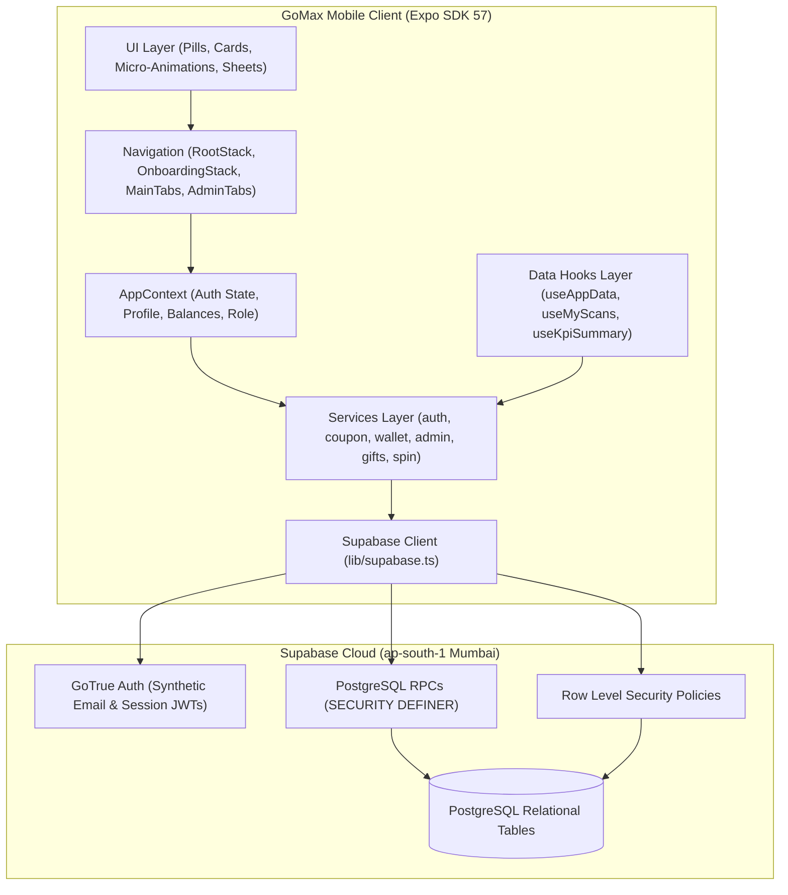
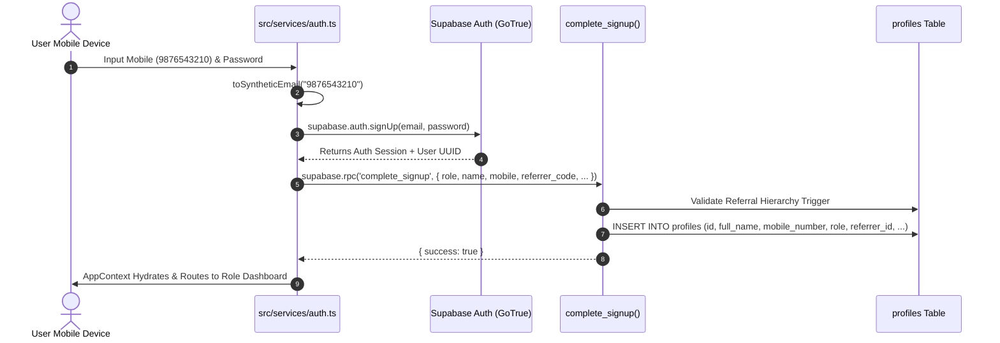
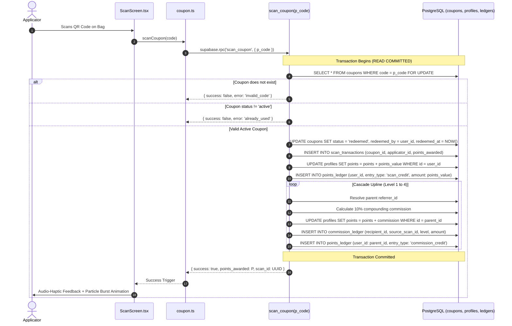
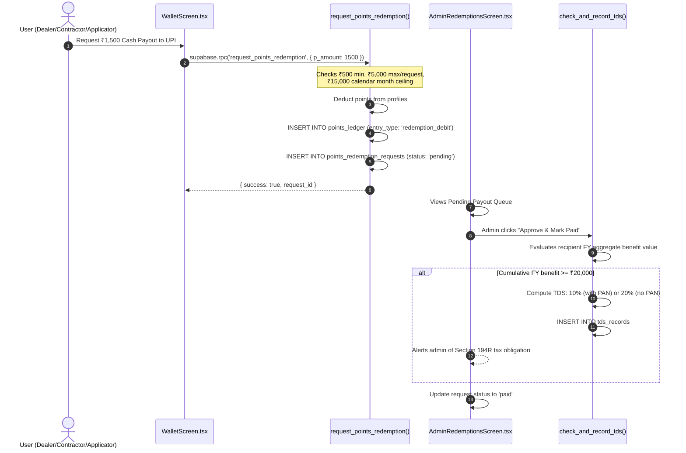
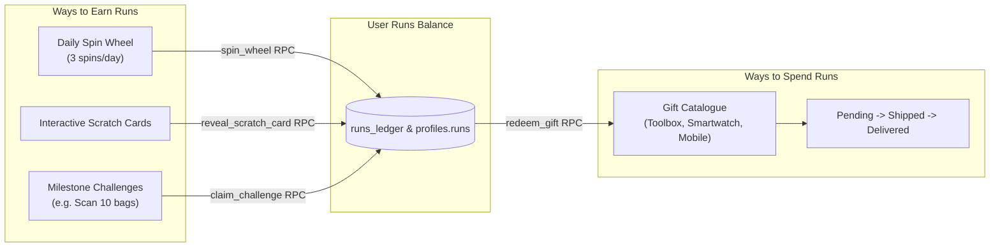
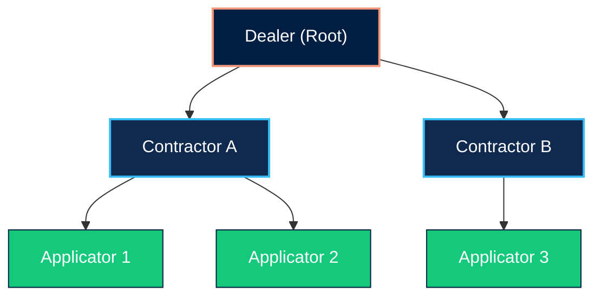

# GoMax App — Comprehensive Architecture, Technical Manual & Developer Guide

> **Admin panel moved (2026-10-30).** Client requirement: the admin panel is **website-only**. The old in-app Admin Suite (sections 7.4 and 9.5 below, `src/screens/admin`, `AdminTabNavigator`, `services/admin.ts`, Admin Setup) has been removed from this app. Admin accounts can't sign in to the app. The office uses the GoMax Admin website in `../admin-web` (admin.gomax.in) on the `../backend` API. The sections below are kept as history.


> **Version**: 1.0.0 (Expo SDK 57 / React Native 0.86 / Supabase-PostgreSQL)
> **Target Audience**: Software Engineers, Full-Stack Developers, Architects, Product Managers & Auditors  
> **Repository**: [GOMAX_APP](file:///c:/Projects/sanidhi/app/GOMAX_APP)  
> **Last Updated**: September 2026
---
## Table of Contents

1. [Executive Summary & System Purpose](#1-executive-summary--system-purpose)
2. [Feature Catalog & System Capabilities](#2-feature-catalog--system-capabilities)
3. [Technology Stack & Core Dependencies](#3-technology-stack--core-dependencies)
4. [System Architecture & Data Flows](#4-system-architecture--data-flows)
   - [4.1 High-Level System Architecture](#41-high-level-system-architecture)
   - [4.2 Authentication & Synthetic Email Protocol](#42-authentication--synthetic-email-protocol)
   - [4.3 Coupon Scan & 4-Level Compounding Referral Cascade](#43-coupon-scan--4-level-compounding-referral-cascade)
   - [4.4 Points Cash Redemption & TDS Flow](#44-points-cash-redemption--tds-flow)
   - [4.5 Runs Gamification (Spin Wheel, Scratch Cards, Challenges)](#45-runs-gamification-spin-wheel-scratch-cards-challenges)
   - [4.6 Downline Hierarchy & Business Volume Aggregation](#46-downline-hierarchy--business-volume-aggregation)
5. [Backend Architecture & Database Design Deep Dive](#5-backend-architecture--database-design-deep-dive)
   - [5.1 Live Supabase Infrastructure](#51-live-supabase-infrastructure)
   - [5.2 Database Entity Relationship Overview](#52-database-entity-relationship-overview)
   - [5.3 Comprehensive Table Inventory & Data Dictionary](#53-comprehensive-table-inventory--data-dictionary)
   - [5.4 PostgreSQL Stored Procedures (RPCs) & Concurrency Controls](#54-postgresql-stored-procedures-rpcs--concurrency-controls)
   - [5.5 Security Model: SECURITY DEFINER, Search Path & RLS Policies](#55-security-model-security-definer-search-path--rls-policies)
   - [5.6 Indian Tax Compliance: Section 194R TDS Engine](#56-indian-tax-compliance-section-194r-tds-engine)
6. [Frontend Architecture & Design System](#6-frontend-architecture--design-system)
   - [6.1 Layered Frontend Structure](#61-layered-frontend-structure)
   - [6.2 Design Tokens (Colors, Typography, Spacing)](#62-design-tokens-colors-typography-spacing)
   - [6.3 Reusable Component Library & Micro-Animations](#63-reusable-component-library--micro-animations)
   - [6.4 State Management (AppContext) & Custom Data Hooks](#64-state-management-appcontext--custom-data-hooks)
7. [Comprehensive Frontend Screen Inventory (All 25 Screens)](#7-comprehensive-frontend-screen-inventory-all-25-screens)
   - [7.1 Onboarding & Authentication Screens (5 screens)](#71-onboarding--authentication-screens-5-screens)
   - [7.2 Main App Screens (6 screens)](#72-main-app-screens-6-screens)
   - [7.3 Engagement & Modal Screens (5 screens)](#73-engagement--modal-screens-5-screens)
   - [7.4 Admin Suite Screens (8 screens)](#74-admin-suite-screens-8-screens)
   - [7.5 Developer & Tooling Screens (1 screen)](#75-developer--tooling-screens-1-screen)
8. [Codebase Anatomy & Exhaustive File Inventory](#8-codebase-anatomy--exhaustive-file-inventory)
9. [Developer Guide & Practical How-Tos](#9-developer-guide--practical-how-tos)
   - [9.1 Prerequisites & Local Environment Setup](#91-prerequisites--local-environment-setup)
   - [9.2 Running Locally (Android, iOS, Web)](#92-running-locally-android-ios-web)
   - [9.3 How to Add New Features to the Backend (Step-by-Step Tutorial)](#93-how-to-add-new-features-to-the-backend-step-by-step-tutorial)
   - [9.4 Seeding Test Data (Coupons, Gifts, Challenges)](#94-seeding-test-data-coupons-gifts-challenges)
   - [9.5 Admin Account Bootstrapping](#95-admin-account-bootstrapping)
   - [9.6 Single-File Web Standalone Production Preview](#96-single-file-web-standalone-production-preview)
10. [Known Operational Gaps & Production Roadmap](#10-known-operational-gaps--production-roadmap)

---

## 1. Executive Summary & System Purpose

**GoMax** is an enterprise loyalty, multi-tier referral distribution, and dealer-applicator engagement mobile platform specifically engineered for the construction chemicals and surface coatings industry (tile adhesives, waterproofing chemicals, wall putty, decorative coatings, cement, and repair mortars).

### The Business Challenge
In the building materials and construction chemical sectors, purchase decisions are heavily driven by the hands-on craftsmen—**Applicators** (masons, tile layers, and painters)—as well as the **Contractors** and **Dealers** who supply the materials. Traditional offline coupon promotions suffer from:
1. High fraud and duplicate redemption risks.
2. Zero visibility into the multi-layer referral and sales network.
3. Tax non-compliance with Indian statutory withholding requirements (Section 194R TDS).
4. Low daily engagement beyond the occasional coupon scan.

### The GoMax Solution
GoMax transforms this ecosystem into a transparent, gamified, and legally compliant digital network:
- **Instant Rewards**: Applicators scan physical QR coupons printed on product packaging, instantly receiving cash-convertible **Points** into their in-app wallet.
- **Compounding Referral Network**: A strict 4-level upline referral tree distributes passive commissions up the chain (Dealers $\rightarrow$ Contractors $\rightarrow$ Applicators).
- **Dual-Currency Engagement**: Aside from cash Points, users earn non-monetary **Runs** through daily spin wheels, scratch cards, and challenges, which can only be spent in an in-app physical gift catalogue (tools, smartphones, appliances).
- **Statutory Tax Shield**: Automated Section 194R TDS tracking and flagging whenever a recipient surpasses ₹20,000 in incentives in a financial year.
- **Operations Command Center**: Full admin visibility with universal ledger search by mobile number, one-click payout approvals, and dynamic catalogue management.

---

## 2. Feature Catalog & System Capabilities

| Feature Category | Capability | Primary User Roles | Technical Implementation |
|---|---|---|---|
| **Authentication** | Mobile + Password sign-in via synthetic email | All | `authService.login()`, Supabase GoTrue |
| **Registration** | Role-gated signup with live upline validation | All | `complete_signup()` RPC, DB trigger |
| **Account Recovery** | Two-factor forgot-password (OTP + Security Question) | All | `otp_codes` table + security question match |
| **Admin Setup** | One-time bootstrap for master administrator | Admin | `bootstrap_admin_account()` RPC |
| **Coupon Scanning** | Hardware camera QR scanning with torch & manual entry | Applicator | `scan_coupon()` RPC, `expo-camera`, row locks |
| **Referral Cascade** | 4-level compounding upline commission (10% per level) | Dealer, Contractor, Applicator | Server-side recursive loop in `scan_coupon()` |
| **Cash Redemptions** | Bank account / UPI cash payout requests | Dealer, Contractor, Applicator | `request_points_redemption()`, monthly ₹15k cap |
| **Tax Compliance** | Section 194R Indian TDS computation (10% PAN / 20% Non-PAN) | Admin, All | `check_and_record_tds()`, `tds_records` |
| **Daily Spin Wheel** | Decelerating 8-slice SVG wheel (max 3 spins/day) | All Users | `spin_wheel()` RPC, Reanimated, Haptics |
| **Scratch Cards** | Mystery Runs rewards revealed via interactive scratch | All Users | `reveal_scratch_card()` RPC, Reanimated |
| **Challenges** | Milestone missions (e.g. scan 10 bags this week) | All Users | `claim_challenge()` RPC, progress tracking |
| **Gift Catalogue** | Runs-based merchandise store with stock management | All Users | `redeem_gift()` RPC, atomic inventory decrement |
| **Gift Fulfillment** | 3-stage logistics tracking (Pending $\rightarrow$ Shipped $\rightarrow$ Delivered) | Admin | `adminService.updateGiftRedemptionStatus()` |
| **Team Tree** | Unlimited-depth downline tree with commission & volume | Dealer, Contractor | Recursive CTE `get_my_downline()` |
| **Lifetime Tiers** | Bronze, Silver, Gold, Platinum status based on lifetime points | All Users | `get_my_tier()` RPC, `tier_bands` |
| **Digital Card** | Dynamic digital membership card with QR representation | All Users | Deterministic pattern rendering in `ProfileScreen` |
| **Full Ledgers** | Itemized debit/credit transaction history for Points and Runs | All Users | `points_ledger`, `runs_ledger` queries |
| **Admin Command** | Executive dashboard with live KPIs and pending queues | Admin | `useKpiSummary()`, `adminService` |
| **Dispute Search** | Universal ledger inspection by 10-digit mobile number | Admin | `getUserLedgerByMobile()`, full profile join |
| **Admin In-App CRUD** | Create and edit gift catalogue items and challenges | Admin | Direct Supabase RLS-governed mutation |

---

## 3. Technology Stack & Core Dependencies

GoMax is built on **React Native 0.86.0** with **Expo SDK 57**, typed end-to-end with **TypeScript 6.0**, communicating with a **Supabase PostgreSQL** cloud backend.

```
+-----------------------------------------------------------------------------------+
|                                  GoMax Client                                     |
|             React Native 0.86.0 | React 19.2.3 | Expo SDK ~57.0.8 | TS 6.0         |
|                                                                                   |
|  • Navigation : @react-navigation/native 7.3, native-stack 7.18, tabs 7.18       |
|  • Animations : react-native-reanimated 4.5.0 & react-native-worklets 0.10        |
|  • Hardware   : expo-camera 57.0.3, expo-haptics 57.0.1, expo-clipboard 57.0.1    |
|  • Graphics   : react-native-svg 15.15.5, expo-linear-gradient 57.0.1             |
|  • Storage    : @react-native-async-storage/async-storage 3.1.1                   |
|  • Typography : @expo-google-fonts/inter 0.4.2 & @expo-google-fonts/roboto 0.4.3 |
+-----------------------------------------------------------------------------------+
                                          │
                                          │ HTTPS (TLS 1.3) / WebSocket
                                          ▼
+-----------------------------------------------------------------------------------+
|                                Supabase Platform                                  |
|                 Project: dealer-crm | Region: ap-south-1 (Mumbai)                 |
|                                                                                   |
|  • Auth Engine  : GoTrue Auth with Synthetic Email mappings                       |
|  • Database     : PostgreSQL 14.5 with Row Level Security (RLS)                   |
|  • Logic Engine : 12+ Atomic PL/pgSQL Stored Functions (SECURITY DEFINER)         |
|  • Concurrency  : Row-Level Locking (SELECT ... FOR UPDATE)                       |
+-----------------------------------------------------------------------------------+
```

### Key Dependencies Breakdown ([package.json](file:///c:/Projects/sanidhi/app/GOMAX_APP/package.json))
- **`expo` (`~57.0.8`)**: Universal cross-platform native runtime.
- **`@supabase/supabase-js` (`^2.111.0`)**: PostgreSQL client, authentication manager, and RPC executor.
- **`react-native-reanimated` (`^4.5.0`)**: Powers high-performance 60fps animations: rotating glowing border rings, camera sweep line, prize wheel physics, card flip unlocks, and particle bursts.
- **`expo-camera` (`^57.0.3`)**: Device camera access for high-speed barcode and QR code reading with flash/torch control.
- **`expo-haptics` (`^57.0.1`)**: Multi-level tactile vibrations on scan verification, button clicks, and reward unlocks.
- **`react-native-svg` (`^15.15.5`)**: Vector graphic rendering for the GoMax logo, circular progress indicators, and wheel wedges.
- **`@react-native-async-storage/async-storage` (`^3.1.1`)**: Local persistence for Supabase authentication tokens.
- **`react-native-url-polyfill` (`^4.0.0`)**: URL standard polyfill required by Supabase within React Native environments.

---

## 4. System Architecture & Data Flows

### 4.1 High-Level System Architecture



---

### 4.2 Authentication & Synthetic Email Protocol

Because users in the Indian trades sector identify exclusively by their 10-digit mobile numbers, GoMax translates phone numbers into synthetic email strings to leverage standard Supabase GoTrue Auth without forcing users to type fake email addresses:

$$\text{User Mobile: } 9876543210 \longrightarrow \text{Synthetic Email: } \texttt{m9876543210@gomaxusers.app}$$



---

### 4.3 Coupon Scan & 4-Level Compounding Referral Cascade

The coupon scanning pipeline is fully encapsulated within a single transactional PostgreSQL function `scan_coupon(p_code)` to prevent race conditions and guarantee atomicity:



#### The Compounding Mathematical Formula
If an Applicator scans a coupon worth $P$ points:
- **Level 1 (Direct Referrer)**: $C_1 = 0.10 \times P$
- **Level 2 (Grand-Referrer)**: $C_2 = 0.10 \times C_1 = 0.01 \times P$
- **Level 3 (Great-Grand-Referrer)**: $C_3 = 0.10 \times C_2 = 0.001 \times P$
- **Level 4 (Great-Great-Grand-Referrer)**: $C_4 = 0.10 \times C_3 = 0.0001 \times P$

---

### 4.4 Points Cash Redemption & TDS Flow



---

### 4.5 Runs Gamification (Spin Wheel, Scratch Cards, Challenges)



---

### 4.6 Downline Hierarchy & Business Volume Aggregation

GoMax tracks full downline trees down to arbitrary depth using a recursive Common Table Expression (**CTE**) in PostgreSQL (`get_my_downline()`):



- **Per-Member Commission**: The viewer sees exactly how much commission they earned specifically from that individual's scans.
- **Team Business Volume**: The recursive function sums the total ₹ coupon value scanned by each person **plus everyone below them in their sub-team**, enabling volume-based incentive schemes.

---

## 5. Backend Architecture & Database Design Deep Dive

### 5.1 Live Supabase Infrastructure

| Attribute | Specification |
|---|---|
| **Project Name** | `dealer-crm` |
| **Project Ref** | `phbvjhwimvzoaxjartzn` |
| **Region** | `ap-south-1` (Mumbai, India) |
| **Database Engine** | PostgreSQL 14.5 |
| **Auth Provider** | Supabase GoTrue with synthetic email mapping |
| **Connection Client** | `@supabase/supabase-js` v2.111.0 |

---

### 5.2 Database Entity Relationship Overview

```
 ┌──────────────────────┐         ┌───────────────────────────────┐
 │       coupons        │         │            profiles           │
 ├──────────────────────┤         ├───────────────────────────────┤
 │ id (UUID, PK)        │         │ id (UUID, PK, FK auth.users)  │
 │ code (TEXT, UNIQUE)  │         │ mobile_number (TEXT, UNIQUE)  │
 │ points_value (INT)   │         │ full_name (TEXT)              │
 │ status (TEXT)        │         │ role (TEXT)                   │
 │ redeemed_by (FK)─────┼────┐    │ referrer_id (UUID, FK)────────┼──┐ (Self-referencing tree)
 └──────────────────────┘    │    │ points (NUMERIC)              │  │
                             │    │ runs (INT)                    │  │
                             ▼    │ pan_number (TEXT)             │  │
 ┌──────────────────────────────┐ │ upi_id (TEXT)                 │  │
 │      scan_transactions       │ └───────┬───────────────┬───────┘  │
 ├──────────────────────────────┤         │               │          │
 │ id (UUID, PK)                │         │               │          │
 │ coupon_id (FK)               │         │               │          │
 │ applicator_id (FK)───────────┼─────────┘               │          │
 │ points_awarded (NUMERIC)     │                         │          │
 └──────────────┬───────────────┘                         │          │
                │                                         │          │
                ▼                                         ▼          │
 ┌──────────────────────────────┐         ┌────────────────────────┐ │
 │      commission_ledger       │         │     points_ledger      │ │
 ├──────────────────────────────┤         ├────────────────────────┤ │
 │ id (UUID, PK)                │         │ id (UUID, PK)          │ │
 │ source_scan_id (FK)          │         │ user_id (FK)           │ │
 │ recipient_id (FK)────────────┼─────────┤ entry_type (TEXT)      │ │
 │ level (INT: 1-4)             │         │ amount (NUMERIC)       │ │
 │ amount (NUMERIC)             │         │ ref_table / ref_id     │ │
 └──────────────────────────────┘         └────────────────────────┘ │
                                                                     │
 ┌──────────────────────────────┐         ┌────────────────────────┐ │
 │        gift_catalogue        │         │   points_redemption_   │ │
 ├──────────────────────────────┤         │        requests        │ │
 │ id (UUID, PK)                │         ├────────────────────────┤ │
 │ name (TEXT)                  │         │ id (UUID, PK)          │ │
 │ runs_cost (INT)              │         │ user_id (FK)───────────┼─┘
 │ stock (INT)                  │         │ amount (NUMERIC)       │
 │ market_value_inr (NUMERIC)   │         │ status (pending/paid)  │
 └──────────────┬───────────────┘         │ upi_id / bank details  │
                │                         └───────────┬────────────┘
                ▼                                     │
 ┌──────────────────────────────┐                     │
 │       gift_redemptions       │                     ▼
 ├──────────────────────────────┤         ┌────────────────────────┐
 │ id (UUID, PK)                │         │       tds_records      │
 │ user_id (FK)                 │         ├────────────────────────┤
 │ gift_id (FK)                 │         │ id (UUID, PK)          │
 │ runs_spent (INT)             │         │ user_id (FK)           │
 │ status (pending/ship/deliv)  │         │ benefit_type (TEXT)    │
 └──────────────┬───────────────┘         │ benefit_value (NUMERIC)│
                │                         │ cumulative_fy_value    │
                └─────────────────────────┤ tds_rate / tds_amount  │
                                          └────────────────────────┘
```

---

### 5.3 Comprehensive Table Inventory & Data Dictionary

| Table Name | Primary Purpose | Key Columns & Types | Constraints & Indexes |
|---|---|---|---|
| **`profiles`** | Core user record linked 1:1 with `auth.users` | `id` (UUID), `full_name` (TEXT), `mobile_number` (TEXT), `role` (TEXT), `referrer_id` (UUID), `points` (NUMERIC), `runs` (INT), `pan_number` (TEXT), `aadhaar_number` (TEXT), `upi_id` (TEXT), `bank_account_number` (TEXT), `bank_ifsc` (TEXT), `security_question` (TEXT), `security_answer_hash` (TEXT), `referral_code` (TEXT) | PK on `id`, UNIQUE(`mobile_number`), UNIQUE(`referral_code`), FK(`referrer_id` $\rightarrow$ `profiles.id`) |
| **`coupons`** | Physical vouchers printed on bags | `id` (UUID), `code` (TEXT), `points_value` (INT), `status` (TEXT: 'active'/'redeemed'/'void'), `redeemed_by` (UUID), `redeemed_at` (TIMESTAMPTZ) | PK on `id`, UNIQUE(`code`), Index on `status` |
| **`scan_transactions`** | Immutable audit log of every scan | `id` (UUID), `coupon_id` (UUID), `applicator_id` (UUID), `points_awarded` (NUMERIC), `created_at` (TIMESTAMPTZ) | PK on `id`, FK(`coupon_id`), FK(`applicator_id`), Index on `(applicator_id, created_at)` |
| **`commission_ledger`** | 4-level upline commission logs | `id` (UUID), `source_scan_id` (UUID), `recipient_id` (UUID), `level` (INT: 1-4), `amount` (NUMERIC), `created_at` (TIMESTAMPTZ) | PK on `id`, FK(`source_scan_id`), FK(`recipient_id`), Index on `recipient_id` |
| **`points_ledger`** | Financial double-entry ledger for Points | `id` (UUID), `user_id` (UUID), `entry_type` (TEXT: 'scan_credit'/'commission_credit'/'redemption_debit'/'adjustment'), `amount` (NUMERIC), `ref_table` (TEXT), `ref_id` (UUID), `created_at` (TIMESTAMPTZ) | PK on `id`, FK(`user_id`), Index on `(user_id, created_at)` |
| **`runs_ledger`** | Accounting ledger for Runs | `id` (UUID), `user_id` (UUID), `entry_type` (TEXT: 'spin_credit'/'scratch_credit'/'challenge_credit'/'gift_debit'), `amount` (INT), `ref_table` (TEXT), `ref_id` (UUID), `created_at` (TIMESTAMPTZ) | PK on `id`, FK(`user_id`), Index on `(user_id, created_at)` |
| **`points_redemption_requests`** | Formal user cash-out requests | `id` (UUID), `user_id` (UUID), `amount` (NUMERIC), `status` (TEXT: 'pending'/'approved'/'paid'/'rejected'), `upi_id` (TEXT), `bank_account_number` (TEXT), `bank_ifsc` (TEXT), `requested_at` (TIMESTAMPTZ), `decided_at` (TIMESTAMPTZ), `decided_by` (UUID) | PK on `id`, FK(`user_id`), Index on `(user_id, status)` |
| **`gift_catalogue`** | Catalog of physical rewards for Runs | `id` (UUID), `name` (TEXT), `category` (TEXT), `description` (TEXT), `runs_cost` (INT), `stock` (INT), `market_value_inr` (NUMERIC), `image_url` (TEXT), `active` (BOOLEAN) | PK on `id`, Index on `active` |
| **`gift_redemptions`** | Gift claims and fulfillment log | `id` (UUID), `user_id` (UUID), `gift_id` (UUID), `runs_spent` (INT), `status` (TEXT: 'pending'/'shipped'/'delivered'), `shipping_address` (TEXT), `proof_url` (TEXT), `tracking_carrier` (TEXT), `tracking_number` (TEXT), `created_at` (TIMESTAMPTZ) | PK on `id`, FK(`user_id`), FK(`gift_id`), Index on `(user_id, status)` |
| **`spin_wheel_prizes`** | 8-slice wheel configurations | `id` (UUID), `slice_index` (INT), `label` (TEXT), `runs_value` (INT), `weight` (INT), `color` (TEXT), `active` (BOOLEAN) | PK on `id`, Index on `active` |
| **`spin_wheel_spins`** | Daily spin limit enforcement | `id` (UUID), `user_id` (UUID), `prize_id` (UUID), `runs_awarded` (INT), `spin_date` (DATE), `created_at` (TIMESTAMPTZ) | PK on `id`, FK(`user_id`), Index on `(user_id, spin_date)` |
| **`scratch_cards`** | Scratch card templates | `id` (UUID), `title` (TEXT), `min_runs` (INT), `max_runs` (INT), `active` (BOOLEAN) | PK on `id`, Index on `active` |
| **`user_scratch_cards`** | Instantiated scratch cards per user | `id` (UUID), `user_id` (UUID), `card_id` (UUID), `runs_awarded` (INT), `scratched` (BOOLEAN), `scratched_at` (TIMESTAMPTZ) | PK on `id`, FK(`user_id`), FK(`card_id`) |
| **`challenges`** | Milestone task campaigns | `id` (UUID), `title` (TEXT), `description` (TEXT), `target_type` (TEXT), `target_count` (INT), `runs_reward` (INT), `active` (BOOLEAN) | PK on `id`, Index on `active` |
| **`challenge_progress`** | User progress tracking on tasks | `user_id` (UUID), `challenge_id` (UUID), `current_count` (INT), `completed` (BOOLEAN), `completed_at` (TIMESTAMPTZ) | Compound PK on `(user_id, challenge_id)` |
| **`tier_bands`** | Lifetime points threshold rules | `id` (UUID), `tier_name` (TEXT), `min_lifetime_points` (INT), `perk_description` (TEXT), `sort_order` (INT) | PK on `id`, Sorted by `sort_order` |
| **`tds_records`** | Section 194R statutory audit log | `id` (UUID), `user_id` (UUID), `financial_year` (TEXT), `benefit_type` (TEXT), `benefit_value` (NUMERIC), `cumulative_fy_value` (NUMERIC), `pan_on_file` (BOOLEAN), `tds_applicable` (BOOLEAN), `tds_rate` (NUMERIC), `tds_amount` (NUMERIC), `ref_table` (TEXT), `ref_id` (UUID) | PK on `id`, FK(`user_id`), Index on `(user_id, financial_year)` |
| **`otp_codes`** | 2FA recovery temporary tokens | `id` (UUID), `mobile_number` (TEXT), `otp_code` (TEXT), `expires_at` (TIMESTAMPTZ), `used` (BOOLEAN) | PK on `id`, Index on `mobile_number` |

---

### 5.4 PostgreSQL Stored Procedures (RPCs) & Concurrency Controls

Every state mutation that touches money, inventory, or security is handled through a `SECURITY DEFINER` stored function with strict concurrency protection:

#### 1. `scan_coupon(p_code TEXT)`
- **Concurrency Control**: Issues `SELECT * FROM coupons WHERE code = p_code FOR UPDATE`. Locks the coupon row at transaction start. Multiple simultaneous scans of the same code serialize; the first succeeds and the rest abort with `already_used`.
- **Validation**: Verifies caller profile `role = 'applicator'`.
- **Cascade**: Enters a `WHILE` loop tracking ancestor referrers up to 4 levels, calculating compounding 10% fractions and inserting corresponding entries into `commission_ledger` and `points_ledger`.

#### 2. `request_points_redemption(p_amount NUMERIC)`
- **Validation**: Enforces $500 \le \text{amount} \le 5000$.
- **Monthly Limit**: Calculates `SUM(amount)` from `points_redemption_requests` where status is `pending`, `approved`, or `paid` within the current calendar month; rejects if total would exceed ₹15,000.
- **Balance Lock**: Locks caller profile with `FOR UPDATE` and asserts `points >= p_amount`.
- **Immediate Debit**: Deducts points upfront to prevent double-spending while the request is pending.

#### 3. `redeem_gift(p_gift_id UUID)`
- **Inventory Concurrency**: Locks the gift catalogue item with `SELECT stock, runs_cost FROM gift_catalogue WHERE id = p_gift_id FOR UPDATE`.
- **Stock Assertion**: Rejects with `out_of_stock` if `stock <= 0`.
- **Balance Assertion**: Locks profile and asserts `runs >= runs_cost`.
- **Atomicity**: Decrements `gift_catalogue.stock`, decrements `profiles.runs`, logs `runs_ledger` debit, and inserts `gift_redemptions` row.

#### 4. `get_my_downline()`
- **Recursive CTE**:
  ```sql
  WITH RECURSIVE downline AS (
      SELECT id, full_name, mobile_number, role, referrer_id, 1 AS depth
      FROM profiles
      WHERE referrer_id = auth.uid()
      UNION ALL
      SELECT p.id, p.full_name, p.mobile_number, p.role, p.referrer_id, d.depth + 1
      FROM profiles p
      INNER JOIN downline d ON p.referrer_id = d.id
  )
  ...
  ```
- **Aggregation**: Computes `commission_earned` from `commission_ledger` specifically generated by each member, and rolls up `business_volume` (coupon INR sum) across their entire descendant branch.

#### 5. `get_my_tier()`
- Calculates **Lifetime Points** = $\sum(\text{scan\_credit}) + \sum(\text{commission\_credit})$.
- Resolves current band from `tier_bands`, the next higher band, and calculates the delta points required to upgrade.
- **Core Invariant**: Because it uses lifetime earned points, withdrawing points to a bank account never demotes a user's tier.

#### 6. `check_and_record_tds(...)`
- Evaluates the April 1 to March 31 Indian Financial Year.
- Sums all approved cash redemptions and delivered gift market values.
- If cumulative benefit $\ge 20,000$, calculates TDS at **10%** (if `pan_number` is populated) or **20%** (if `pan_number` is null), inserting an audit row into `tds_records`.

#### 7. `spin_wheel()`
- Queries `spin_wheel_spins` for count where `user_id = auth.uid()` and `spin_date = CURRENT_DATE`. Rejects if count $\ge 3$.
- Executes weighted random selection over `spin_wheel_prizes`, credits `profiles.runs`, logs `runs_ledger`, and records the spin.

---

### 5.5 Security Model: SECURITY DEFINER, Search Path & RLS Policies

1. **`SECURITY DEFINER` with fixed `search_path`**:
   All GoMax RPC functions specify `SECURITY DEFINER` and `SET search_path = public`. This elevates the execution context to bypass table-level RLS while strictly maintaining user identity via `auth.uid()`, preventing search-path hijacking attacks.
2. **Row Level Security (RLS) Configuration**:
   - `profiles`: Users can `SELECT` and `UPDATE` only their own row (`id = auth.uid()`). Admins have full access.
   - `coupons`: Direct inserts/updates by normal users are blocked. Scans must go through `scan_coupon()`.
   - `points_ledger` & `runs_ledger`: Immutable append-only tables; direct user writes are blocked.
   - `points_redemption_requests`: Users can `INSERT` (via RPC) and `SELECT` their own requests. Only users with `role = 'admin'` can update `status` to approved/paid/rejected.
   - `gift_catalogue`: Public read access for active items. Write access (INSERT/UPDATE/DELETE) restricted to `role = 'admin'`.

---

### 5.6 Indian Tax Compliance: Section 194R TDS Engine

Under Indian Income Tax regulations (Section 194R, recodified under 393(1)), any business providing perks, incentives, or rewards exceeding ₹20,000 in aggregate to a resident in a single financial year must withhold tax:
- **Financial Year Window**: April 1st to March 31st.
- **Threshold**: Aggregate value $\ge ₹20,000$.
- **Applicable Rate**:
  - **10%** if valid PAN is provided.
  - **20%** if PAN is missing (higher deduction for non-PAN compliance).
- **In-App Handling**:
  - The GoMax engine does not deduct money from the user's requested cash-out; it acts as an **auditing and compliance flagger**.
  - When an admin approves a redemption or marks a gift delivered, the system evaluates the threshold, creates a record in `tds_records`, and displays a clear statutory alert banner in the Admin portal so the finance team can file Form 26Q and deposit TDS accordingly.

---

## 6. Frontend Architecture & Design System

### 6.1 Layered Frontend Structure

The frontend application follows a clean 7-layer architecture:

```
┌────────────────────────────────────────────────────────┐
│ 1. Screens (src/screens/*)                             │  Presentation views & workflows
├────────────────────────────────────────────────────────┤
│ 2. Navigation (src/navigation/*)                       │  Stacks, Tab bars, Route gating
├────────────────────────────────────────────────────────┤
│ 3. State & Context (src/state/AppContext.tsx)          │  Session, Role, User Balances
├────────────────────────────────────────────────────────┤
│ 4. Data Hooks (src/hooks/useAppData.ts)                │  SWR-style fetching, local caches
├────────────────────────────────────────────────────────┤
│ 5. Services Layer (src/services/*)                     │  Typed Supabase RPC callers
├────────────────────────────────────────────────────────┤
│ 6. Component Library (src/components/*)                │  Buttons, Cards, Pills, Inputs
├────────────────────────────────────────────────────────┤
│ 7. Theme & Tokens (src/theme/*)                        │  Colors, Typography, 4px Spacing
└────────────────────────────────────────────────────────┘
```

---

### 6.2 Design Tokens (Colors, Typography, Spacing)

The design system implements a premium, dark-accented aesthetic tailored for high legibility on construction sites:

#### Color Tokens ([src/theme/colors.ts](file:///c:/Projects/sanidhi/app/GOMAX_APP/src/theme/colors.ts))
- **Brand Navy**: `#001E42` (Primary Brand Navy), `#0a1c37` (`navy900`), `#0f2a4e` (`navy800`).
- **Brand Orange / Accent**: `#c05336` (`primary700`), `#e07554` (`primary600`), `#F3987A` (`brandOrange`).
- **Surfaces**: `#ffffff` (`surface`), `#f0f4fa` (`surfaceMuted`), `#0a1628` (`walletBg`), `#0d1f3c` (`walletCard`).
- **Status Tints**: `#14c87c` (`scanSuccessGreen`), `#f59e0b` (`warning`), `#ef4444` (`danger`), `#38bdf8` (`infoBlue`).

#### Typography Tokens ([src/theme/typography.ts](file:///c:/Projects/sanidhi/app/GOMAX_APP/src/theme/typography.ts))
- **Headings**: Roboto (`Roboto_700Bold`, `Roboto_600SemiBold`).
- **Body & Captions**: Inter (`Inter_400Regular`, `Inter_500Medium`, `Inter_600SemiBold`).
- **Data & Numbers**: Large bold tabular numbers for wallet balances and coupon values.

#### Spacing Tokens ([src/theme/spacing.ts](file:///c:/Projects/sanidhi/app/GOMAX_APP/src/theme/spacing.ts))
- Base 4px grid: `xs: 4`, `sm: 8`, `md: 12`, `lg: 16`, `xl: 24`, `xxl: 32`.

---

### 6.3 Reusable Component Library & Micro-Animations

All components are located in [src/components/](file:///c:/Projects/sanidhi/app/GOMAX_APP/src/components/):
- **`Button.tsx`**: Supports `primary`, `secondary`, `outline`, and `ghost` variants with automatic tactile haptic response.
- **`Card.tsx`**: Elevation surfaces with consistent border radius (`16px`), padding, and subtle drop shadows.
- **`Pill.tsx`**: Status badges supporting `success`, `warning`, `danger`, `info`, and `neutral` color variants.
- **`StatTile.tsx`**: KPI display tile featuring an icon container, value label, and descriptive caption.
- **`TextField.tsx`**: Form inputs with clear focus outlines, helper text, and validation error messages.
- **`SelectModal.tsx`**: Bottom-sheet modal for selecting options (roles, security questions).
- **`GoMaxLogo.tsx`**: Native SVG vector logo with options for full wordmark, icon-only, orange, and white fills.
- **`BottomNav.tsx`**: High-end bottom navigation bar with active glow indicators.

#### Micro-Interaction Components ([src/components/animations/](file:///c:/Projects/sanidhi/app/GOMAX_APP/src/components/animations/))
- **`GlowBorder.tsx`**: Rotating conic-gradient animated border for high-priority CTAs (e.g. "Scan QR").
- **`PressableScale.tsx`**: Native spring-physics touch scale animation (`scale: 0.97`) on all interactive cards and tiles.
- **`RewardBurst.tsx`**: Multi-colored particle confetti burst for successful coupon scans and prize claims.
- **`UnlockReveal.tsx`**: Smooth vertical slide and fade-in reveal for newly unlocked scratch cards and tier badges.

---

### 6.4 State Management (AppContext) & Custom Data Hooks

#### Global AppContext ([src/state/AppContext.tsx](file:///c:/Projects/sanidhi/app/GOMAX_APP/src/state/AppContext.tsx))
Provides app-wide access via `useApp()`:
- `isAuthenticated`, `sessionLoading`, `role` (`'dealer' | 'contractor' | 'applicator' | 'admin'`)
- User profile info: `fullName`, `mobileNumber`, `city`, `address`, `upiId`, `bankAccountNumber`, `bankIfsc`, `panNumber`, `aadhaarNumber`
- Balances: `points`, `runs`, `referralCode`
- Authentication functions: `logIn()`, `signUp()`, `logOut()`, `adminLogin()`, `adminLogout()`, `refreshProfile()`

#### Custom Data Hooks ([src/hooks/useAppData.ts](file:///c:/Projects/sanidhi/app/GOMAX_APP/src/hooks/useAppData.ts))
Encapsulates fetching, local caching, and pull-to-refresh:
- `useMyScans()`: List of past coupon scans.
- `useMyRedemptions()`: Payout history.
- `useRedeemedThisMonth()`: Current monthly withdrawal sum.
- `useMyCommissionEarnings()`: Itemized referral earnings.
- `useKpiSummary()`: Admin live statistics (users count, scans today, monthly points).
- `useAllRedemptions()`: Admin pending and past payouts list.
- `useGiftRedemptionsAdmin(status)`: Admin gift delivery tracker.
- `useApplicators()`: Directory of registered users.

---

## 7. Comprehensive Frontend Screen Inventory (All 25 Screens)

Every screen in GoMax is built with strict TypeScript typing, haptic responses, and safe-area boundaries:

### 7.1 Onboarding & Authentication Screens (5 screens)

| # | Screen Name | File Path | Route Key | Target Role | Purpose & Features |
|---|---|---|---|---|---|
| 1 | **SplashScreen** | [SplashScreen.tsx](file:///c:/Projects/sanidhi/app/GOMAX_APP/src/screens/onboarding/SplashScreen.tsx) | `Splash` | Public | Brand presentation, session auto-hydration, "Get Started" button, staff admin login link, and dev design system launcher. |
| 2 | **LoginScreen** | [LoginScreen.tsx](file:///c:/Projects/sanidhi/app/GOMAX_APP/src/screens/onboarding/LoginScreen.tsx) | `Login` | Public | 10-digit mobile number and password sign-in; handles automatic synthetic email conversion and invalid credential errors. |
| 3 | **SignupScreen** | [SignupScreen.tsx](file:///c:/Projects/sanidhi/app/GOMAX_APP/src/screens/onboarding/SignupScreen.tsx) | `Signup` | Public | Multi-step registration: validates referral code in real-time, filters allowed roles, collects KYC/UPI details, and sets 2FA security question. |
| 4 | **ForgotPasswordScreen** | [ForgotPasswordScreen.tsx](file:///c:/Projects/sanidhi/app/GOMAX_APP/src/screens/onboarding/ForgotPasswordScreen.tsx) | `ForgotPassword` | Public | Two-factor password recovery: requests mobile OTP and verifies answer to the user's specific security question before resetting password. |
| 5 | **AdminSetupScreen** | [AdminSetupScreen.tsx](file:///c:/Projects/sanidhi/app/GOMAX_APP/src/screens/onboarding/AdminSetupScreen.tsx) | `AdminSetup` | Public (First Run) | One-time bootstrap screen for initializing the master system Administrator account; permanently locks once an admin exists. |

---

### 7.2 Main App Screens (6 screens)

| # | Screen Name | File Path | Route Key | Target Role | Purpose & Features |
|---|---|---|---|---|---|
| 6 | **MasonHomeScreen** | [MasonHomeScreen.tsx](file:///c:/Projects/sanidhi/app/GOMAX_APP/src/screens/home/MasonHomeScreen.tsx) | `Home` (Adaptive) | Applicator | Visual, icon-rich dashboard: greeting avatar, quick-action tiles (Spin Wheel, Scratch Cards, Challenges, Referral Share), and material category tiles. |
| 7 | **HomeScreen** | [HomeScreen.tsx](file:///c:/Projects/sanidhi/app/GOMAX_APP/src/screens/home/HomeScreen.tsx) | `Home` (Adaptive) | Dealer, Contractor | Business dashboard: live Points and Runs balances, downline commission earnings summary, and referral code copy/share card. |
| 8 | **ScanScreen** | [ScanScreen.tsx](file:///c:/Projects/sanidhi/app/GOMAX_APP/src/screens/scan/ScanScreen.tsx) | `Scan` | Applicator | Hardware camera QR scanner: Reanimated sweep line, torch toggle, manual code entry modal, and recent scan history list. |
| 9 | **WalletScreen** | [WalletScreen.tsx](file:///c:/Projects/sanidhi/app/GOMAX_APP/src/screens/wallet/WalletScreen.tsx) | `Wallet` | Dealer, Contractor, Applicator | Financial hub: real-time Points wallet, inline UPI ID editor, preset redemption chips (₹500, ₹1000, ₹2500, All), monthly limit progress, and payout history. |
| 10 | **GiftCatalogueScreen** | [GiftCatalogueScreen.tsx](file:///c:/Projects/sanidhi/app/GOMAX_APP/src/screens/gifts/GiftCatalogueScreen.tsx) | `Gifts` | All Users | Merchandise catalogue: browse physical tools and electronics, check stock levels, view Runs costs, and claim rewards with delivery addresses. |
| 11 | **ProfileScreen** | [ProfileScreen.tsx](file:///c:/Projects/sanidhi/app/GOMAX_APP/src/screens/profile/ProfileScreen.tsx) | `Profile` | All Users | Profile center: renders digital membership card with deterministic QR, lifetime tier progress bar, PAN update modal, KYC status, and secure logout. |

---

### 7.3 Engagement & Modal Screens (5 screens)

| # | Screen Name | File Path | Route Key | Target Role | Purpose & Features |
|---|---|---|---|---|---|
| 12 | **SpinWheelScreen** | [SpinWheelScreen.tsx](file:///c:/Projects/sanidhi/app/GOMAX_APP/src/screens/engagement/SpinWheelScreen.tsx) | `SpinWheel` | All Users | Decelerating 8-slice SVG fortune wheel with physics-based tick sounds/haptics, daily counter (3 spins/day), and celebratory win modal. |
| 13 | **ScratchCardScreen** | [ScratchCardScreen.tsx](file:///c:/Projects/sanidhi/app/GOMAX_APP/src/screens/engagement/ScratchCardScreen.tsx) | `ScratchCards` | All Users | Interactive scratch cards that reveal mystery Runs prizes with foil scratch gestures and particle burst animations. |
| 14 | **ChallengesScreen** | [ChallengesScreen.tsx](file:///c:/Projects/sanidhi/app/GOMAX_APP/src/screens/engagement/ChallengesScreen.tsx) | `Challenges` | All Users | Task mission list: track progress toward bag scan and volume targets, with one-tap reward claiming. |
| 15 | **TeamScreen** | [TeamScreen.tsx](file:///c:/Projects/sanidhi/app/GOMAX_APP/src/screens/team/TeamScreen.tsx) | `Team` | Dealer, Contractor | Downline team viewer: displays members, individual commission contributions, and total rolled-up team business volume. |
| 16 | **LedgerScreen** | [LedgerScreen.tsx](file:///c:/Projects/sanidhi/app/GOMAX_APP/src/screens/ledger/LedgerScreen.tsx) | `Ledger` | All Users | Full itemized accounting ledger: separate tabs for Points and Runs, showing timestamps, descriptions, amounts, and reference IDs. |

---

### 7.4 Admin Suite Screens (8 screens)

| # | Screen Name | File Path | Route Key | Target Role | Purpose & Features |
|---|---|---|---|---|---|
| 17 | **AdminLoginScreen** | [AdminLoginScreen.tsx](file:///c:/Projects/sanidhi/app/GOMAX_APP/src/screens/admin/AdminLoginScreen.tsx) | `AdminLogin` | Admin | Email and password login portal reserved exclusively for staff administrators with real email credentials. |
| 18 | **AdminDashboardScreen** | [AdminDashboardScreen.tsx](file:///c:/Projects/sanidhi/app/GOMAX_APP/src/screens/admin/AdminDashboardScreen.tsx) | `Dashboard` | Admin | Executive command center: live KPI cards (total applicators, scans today, monthly points issued, pending redemptions, gift claims). |
| 19 | **AdminRedemptionsScreen**| [AdminRedemptionsScreen.tsx](file:///c:/Projects/sanidhi/app/GOMAX_APP/src/screens/admin/AdminRedemptionsScreen.tsx) | `Redemptions` | Admin | Payout approval queue: approve, reject, or mark paid, with automatic Section 194R TDS warning alerts if user exceeds ₹20,000. |
| 20 | **AdminGiftsScreen** | [AdminGiftsScreen.tsx](file:///c:/Projects/sanidhi/app/GOMAX_APP/src/screens/admin/AdminGiftsScreen.tsx) | `Gifts` | Admin | Physical gift fulfillment pipeline: transition claims from Pending $\rightarrow$ Shipped $\rightarrow$ Delivered, with tracking numbers and proof URLs. |
| 21 | **AdminApplicatorsScreen**| [AdminApplicatorsScreen.tsx](file:///c:/Projects/sanidhi/app/GOMAX_APP/src/screens/admin/AdminApplicatorsScreen.tsx) | `Directory` | Admin | Universal user directory: search and view all users with resolved upline referrers, roles, contact numbers, and wallet balances. |
| 22 | **AdminLedgerSearchScreen**| [AdminLedgerSearchScreen.tsx](file:///c:/Projects/sanidhi/app/GOMAX_APP/src/screens/admin/AdminLedgerSearchScreen.tsx)| `LedgerSearch`| Admin | Universal dispute resolution tool: enter any 10-digit mobile number to inspect their full profile, points ledger, runs ledger, scans, and claims. |
| 23 | **AdminGiftCatalogueScreen**| [AdminGiftCatalogueScreen.tsx](file:///c:/Projects/sanidhi/app/GOMAX_APP/src/screens/admin/AdminGiftCatalogueScreen.tsx)| `AdminGiftCatalogue`| Admin | In-app CRUD management: create new gift items, update stock counts, edit Runs costs, set market value INR for TDS, or soft-delete. |
| 24 | **AdminChallengesManageScreen**| [AdminChallengesManageScreen.tsx](file:///c:/Projects/sanidhi/app/GOMAX_APP/src/screens/admin/AdminChallengesManageScreen.tsx)| `AdminChallengesManage`| Admin | In-app CRUD management: launch, edit, configure target counts, reward amounts, and activate/deactivate milestone challenges. |

---

### 7.5 Developer & Tooling Screens (1 screen)

| # | Screen Name | File Path | Route Key | Target Role | Purpose & Features |
|---|---|---|---|---|---|
| 25 | **DesignSystemScreen** | [DesignSystemScreen.tsx](file:///c:/Projects/sanidhi/app/GOMAX_APP/src/screens/dev/DesignSystemScreen.tsx) | `DesignSystem` | Developer | Visual design testbed: showcases every button variant, card, pill, stat tile, input state, and micro-animation in a live interactive sandbox. |

---

## 8. Codebase Anatomy & Exhaustive File Inventory

```
c:/Projects/sanidhi/app/GOMAX_APP/
├── App.tsx                          # App root: Loads fonts, initializes GestureHandler, SafeAreaProvider, AppProvider, RootNavigator
├── app.json                         # Expo configuration (app name, bundle ID, orientation, camera permissions, icons)
├── index.ts                         # Metro entry point (calls registerRootComponent(App))
├── package.json                     # NPM packages, dependencies, and build scripts
├── tsconfig.json                    # TypeScript compiler options (strict typing, module resolution)
├── babel.config.js                  # Babel configuration (babel-preset-expo)
├── DESIGN_SYSTEM.md                 # Design token guidelines, Figma variables, and UI principles
├── DOCUMENTATION.md                 # This definitive technical documentation file
├── scripts/
│   └── build-web-preview.mjs        # Production bundler: compiles Expo web build into a single, self-contained HTML file
└── src/
    ├── assets/
    │   └── images.ts                # Bundled local image asset exports
    ├── theme/
    │   ├── colors.ts                # Brand Navy, Orange, surface, text, and status color definitions
    │   ├── spacing.ts               # 4px modular spacing grid tokens (xs to xxl)
    │   ├── typography.ts            # Font families (Inter, Roboto), font sizes, line heights, weights
    │   └── index.ts                 # Central theme barrel export
    ├── components/
    │   ├── Button.tsx               # Versatile tactile button (primary, secondary, outline, ghost)
    │   ├── Card.tsx                 # Standard card container with border radius and elevation shadows
    │   ├── Pill.tsx                 # Status indicator badge (success, warning, danger, info, neutral)
    │   ├── StatTile.tsx             # Dashboard metric tile with icon, title, value, and subtitle
    │   ├── Screen.tsx               # Screen scaffold with SafeArea, background styling, and scroll handling
    │   ├── TextField.tsx            # Form input with focus states, helper text, and validation labels
    │   ├── SelectModal.tsx          # Bottom-sheet modal for selecting options from a list
    │   ├── BottomNav.tsx            # Custom-styled bottom tab bar with animated active indicators
    │   ├── GoMaxLogo.tsx            # SVG vector logo component (full logo, icon-only, orange, white)
    │   ├── SpinWheelPromoCard.tsx   # Dashboard banner advertising the daily fortune wheel
    │   ├── index.ts                 # Component library barrel export
    │   └── animations/
    │       ├── GlowBorder.tsx       # Rotating gradient glow border for primary CTAs
    │       ├── PressableScale.tsx   # Spring physics press feedback component
    │       ├── RewardBurst.tsx      # Confetti particle burst celebration effect
    │       ├── UnlockReveal.tsx     # Card flip/slide-up reveal animation
    │       └── index.ts             # Animations barrel export
    ├── lib/
    │   ├── supabase.ts              # Supabase client singleton configured with AsyncStorage persistence
    │   └── database.types.ts        # Auto-generated TypeScript definitions for the Supabase schema
    ├── services/
    │   ├── auth.ts                  # Synthetic email translation, login, signup, OTP recovery, admin auth
    │   ├── coupon.ts                # scanCoupon RPC caller and listMyScans query
    │   ├── wallet.ts                # requestRedemption, listMyRedemptions, ledgers, getMyTier, getRedeemedThisMonth
    │   ├── gifts.ts                 # listGifts, redeemGift, listMyGiftRedemptions
    │   ├── engagement.ts            # Challenges, scratch cards, badges, and user progress
    │   ├── spin.ts                  # spinWheel RPC and getDailySpinsRemaining query
    │   ├── downline.ts              # getMyDownline RPC caller for team network and volume rollup
    │   ├── profile.ts               # Profile fetch, update KYC, validate referral codes
    │   └── admin.ts                 # Full admin operations: directory, redemptions, gifts, challenges, dispute search, TDS
    ├── state/
    │   └── AppContext.tsx           # Global React Context holding auth session, user profile, role, and balances
    ├── hooks/
    │   └── useAppData.ts            # Reusable SWR-like data fetching hooks with caching and pull-to-refresh
    ├── utils/
    │   └── haptics.ts               # Wrapper utility for expo-haptics (light, medium, heavy, success, error)
    ├── navigation/
    │   ├── types.ts                 # TypeScript type definitions for all navigation parameters and routes
    │   ├── RootNavigator.tsx        # Top-level Stack Navigator managing Onboarding, Main, Modals, and Admin
    │   ├── OnboardingNavigator.tsx  # Authentication stack: Splash, Login, Signup, ForgotPassword, AdminSetup
    │   ├── MainTabNavigator.tsx     # Bottom tab bar for users: Home (adaptive), Gifts, Scan, Wallet, Profile
    │   └── AdminTabNavigator.tsx    # Bottom tab bar for staff: Dashboard, Redemptions, Gifts, Directory, LedgerSearch
    └── screens/
        ├── onboarding/              # User Authentication screens (Splash, Login, Signup, ForgotPassword, AdminSetup)
        ├── home/                    # Role-based Home screens (HomeScreen, MasonHomeScreen)
        ├── scan/                    # QR Camera Scanner screen (ScanScreen)
        ├── wallet/                  # Points wallet & cash payout screen (WalletScreen)
        ├── gifts/                   # Runs merchandise store screen (GiftCatalogueScreen)
        ├── profile/                 # Membership card, tier, and settings screen (ProfileScreen)
        ├── engagement/              # Gamification screens (SpinWheelScreen, ScratchCardScreen, ChallengesScreen)
        ├── team/                    # Downline team network screen (TeamScreen)
        ├── ledger/                  # Itemized transaction ledger screen (LedgerScreen)
        ├── admin/                   # Staff administration suite screens (8 screens)
        └── dev/                     # Component testbed screen (DesignSystemScreen)
```

---

## 9. Developer Guide & Practical How-Tos

### 9.1 Prerequisites & Local Environment Setup

1. **Prerequisites**:
   - Node.js version 18.x or 20.x LTS
   - NPM or Yarn
   - Expo Go app on your physical iOS or Android phone, or Android Studio / Xcode simulators
2. **Environment Configuration**:
   Create a `.env` file in `c:/Projects/sanidhi/app/GOMAX_APP/` (or copy from `.env.example`):
   ```env
   EXPO_PUBLIC_SUPABASE_URL=https://phbvjhwimvzoaxjartzn.supabase.co
   EXPO_PUBLIC_SUPABASE_ANON_KEY=eyJhbGciOiJIUzI1NiIsInR5cCI6IkpXVCJ9...
   ```
   *(Note: The anon key is safe for mobile client exposure; table RLS and stored procedure security protect all data).*

---

### 9.2 Running Locally (Android, iOS, Web)

```bash
# Navigate to the app directory
cd c:/Projects/sanidhi/app/GOMAX_APP

# Install dependencies
npm install

# Start the Expo development server
npm run start

# Launch on Android emulator or connected device via USB
npm run android

# Launch on iOS simulator (macOS required)
npm run ios

# Launch in local web browser
npm run web
```

---

### 9.3 How to Add New Features to the Backend (Step-by-Step Tutorial)

This is the standard engineering workflow whenever you need to add a new entity, endpoint, or business rule to the GoMax platform:

#### Step 1: Create the Database Table with Row Level Security (RLS)
In the Supabase Dashboard SQL Editor (or via migration scripts), define the new table, foreign keys, indexes, and enable RLS:

```sql
-- Example: Creating a "Feedback & Site Visits" table
CREATE TABLE public.site_visits (
    id UUID PRIMARY KEY DEFAULT gen_random_uuid(),
    applicator_id UUID NOT NULL REFERENCES public.profiles(id) ON DELETE CASCADE,
    site_name TEXT NOT NULL,
    city TEXT NOT NULL,
    photo_url TEXT,
    notes TEXT,
    runs_awarded INT DEFAULT 0,
    created_at TIMESTAMPTZ NOT NULL DEFAULT timezone('utc'::text, now())
);

-- Enable Row Level Security (MANDATORY)
ALTER TABLE public.site_visits ENABLE ROW LEVEL SECURITY;

-- Policy: Users can view only their own site visits
CREATE POLICY "Users can read own visits" ON public.site_visits
    FOR SELECT USING (auth.uid() = applicator_id);

-- Policy: Admins can view all visits
CREATE POLICY "Admins can view all visits" ON public.site_visits
    FOR SELECT USING (public.is_admin());
```

#### Step 2: Create a PL/pgSQL Stored Procedure (RPC) with `SECURITY DEFINER`
Encapsulate business logic, validations, balance updates, and transaction locking in a stored procedure:

```sql
CREATE OR REPLACE FUNCTION public.record_site_visit(
    p_site_name TEXT,
    p_city TEXT,
    p_photo_url TEXT,
    p_notes TEXT
)
RETURNS JSONB
LANGUAGE plpgsql
SECURITY DEFINER
SET search_path = public
AS $$
DECLARE
    v_user_id UUID;
    v_visit_id UUID;
    v_runs_reward INT := 50; -- Award 50 Runs for logging a site visit
BEGIN
    v_user_id := auth.uid();
    IF v_user_id IS NULL THEN
        RETURN jsonb_build_object('success', false, 'error', 'unauthenticated');
    END IF;

    -- Insert visit record
    INSERT INTO public.site_visits (applicator_id, site_name, city, photo_url, notes, runs_awarded)
    VALUES (v_user_id, p_site_name, p_city, p_photo_url, p_notes, v_runs_reward)
    RETURNING id INTO v_visit_id;

    -- Credit user Runs balance
    UPDATE public.profiles
    SET runs = runs + v_runs_reward
    WHERE id = v_user_id;

    -- Record in Runs ledger
    INSERT INTO public.runs_ledger (user_id, entry_type, amount, ref_table, ref_id)
    VALUES (v_user_id, 'visit_credit', v_runs_reward, 'site_visits', v_visit_id);

    RETURN jsonb_build_object('success', true, 'visit_id', v_visit_id, 'runs_awarded', v_runs_reward);
END;
$$;
```

#### Step 3: Update TypeScript Definitions (`src/lib/database.types.ts`)
Add the new table and function signatures to [src/lib/database.types.ts](file:///c:/Projects/sanidhi/app/GOMAX_APP/src/lib/database.types.ts):

```typescript
export interface Database {
  public: {
    Tables: {
      site_visits: {
        Row: {
          id: string;
          applicator_id: string;
          site_name: string;
          city: string;
          photo_url: string | null;
          notes: string | null;
          runs_awarded: number;
          created_at: string;
        };
        Insert: { /* ... */ };
        Update: { /* ... */ };
      };
      // ... existing tables ...
    };
    Functions: {
      record_site_visit: {
        Args: { p_site_name: string; p_city: string; p_photo_url: string | null; p_notes: string | null };
        Returns: { success: boolean; error?: string; visit_id?: string; runs_awarded?: number };
      };
      // ... existing functions ...
    };
  };
}
```

#### Step 4: Write the Frontend Service Wrapper (`src/services/visits.ts`)
Create a typed service method in `src/services/`:

```typescript
import { supabase } from '../lib/supabase';
import type { Tables } from '../lib/database.types';

export type SiteVisitRow = Tables<'site_visits'>;

export async function logSiteVisit(params: {
  siteName: string;
  city: string;
  photoUrl?: string;
  notes?: string;
}) {
  const { data, error } = await supabase.rpc('record_site_visit', {
    p_site_name: params.siteName,
    p_city: params.city,
    p_photo_url: params.photoUrl ?? null,
    p_notes: params.notes ?? null,
  });
  if (error) throw error;
  return data as { success: boolean; error?: string; visit_id?: string; runs_awarded?: number };
}

export async function listMySiteVisits(): Promise<SiteVisitRow[]> {
  const { data, error } = await supabase
    .from('site_visits')
    .select('*')
    .order('created_at', { ascending: false });
  if (error) throw error;
  return data ?? [];
}
```

#### Step 5: Expose via Custom Hook (`src/hooks/useAppData.ts`)
Add a React hook with loading, data, and refresh states:

```typescript
export function useMySiteVisits() {
  const [visits, setVisits] = useState<SiteVisitRow[]>([]);
  const [loading, setLoading] = useState(true);

  const reload = useCallback(async () => {
    try {
      setLoading(true);
      const data = await listMySiteVisits();
      setVisits(data);
    } finally {
      setLoading(false);
    }
  }, []);

  useEffect(() => { reload(); }, [reload]);
  return { visits, loading, reload };
}
```

#### Step 6: Connect to Screen UI
Import your hook or service in any screen (e.g. `HomeScreen.tsx` or a new `SiteVisitsScreen.tsx`), wire up inputs, buttons, and call `refreshProfile()` from `useApp()` to immediately reflect the newly earned Runs in the user's header badge!

---

### 9.4 Seeding Test Data (Coupons, Gifts, Challenges)

Before applicators can scan coupons or redeem merchandise in development, seed your Supabase database using the following SQL queries:

```sql
-- 1. Seed Active QR Coupons (worth 100, 250, and 500 points)
INSERT INTO public.coupons (code, points_value, status) VALUES
('GOMAX-TEST-001', 100, 'active'),
('GOMAX-TEST-002', 250, 'active'),
('GOMAX-TEST-003', 500, 'active'),
('GOMAX-TILE-100',  100, 'active'),
('GOMAX-PUTTY-250', 250, 'active')
ON CONFLICT (code) DO NOTHING;

-- 2. Seed Gift Catalogue Merchandise
INSERT INTO public.gift_catalogue (name, category, description, runs_cost, stock, market_value_inr, active) VALUES
('GoMax Pro T-Shirt & Cap Kit', 'Apparel', 'Branded dry-fit workwear kit for applicators', 200, 50, 600, true),
('Professional Notched Trowel Set', 'Tools', 'Stainless steel masonry and tile fixing trowels', 450, 30, 1200, true),
('Heavy Duty Tool Box', 'Tools', 'Multi-compartment shockproof tool organizer', 800, 20, 2500, true),
('Smart Fitness Band', 'Electronics', 'Step tracking, heart rate monitor, waterproof', 1500, 15, 3500, true),
('Android Smartphone', 'Electronics', '5G smartphone with 6.5 inch display', 5000, 5, 12000, true)
ON CONFLICT DO NOTHING;

-- 3. Seed Milestone Challenges
INSERT INTO public.challenges (title, description, target_type, target_count, runs_reward, active) VALUES
('First Bag Master', 'Scan your first product coupon this week', 'scan_count', 1, 50, true),
('Weekend Warrior', 'Scan 5 bags over the weekend', 'scan_count', 5, 200, true),
('Century Club', 'Reach 100 total bags scanned lifetime', 'scan_count', 100, 1500, true)
ON CONFLICT DO NOTHING;
```

---

### 9.5 Admin Account Bootstrapping

1. Start the app: `npm run start` (or `npm run web`).
2. On the **SplashScreen**, click the link in the footer: **"Staff / Admin login"**.
3. If no admin account exists yet, the screen detects this and displays a link: **"Set up initial Admin"**.
4. Enter your admin details (Full Name, Admin Email, Password).
5. The system calls `bootstrap_admin_account()`, creating your admin user with `role = 'admin'` and permanently locking the setup portal.
6. To grant admin access to additional users in the future, run:
   ```sql
   UPDATE public.profiles SET role = 'admin' WHERE id = '<user-uuid>';
   ```

---

### 9.6 Single-File Web Standalone Production Preview

The repository includes a standalone compiler script:
```bash
npm run preview:web
```
**How It Works**:
1. Invokes `expo export --platform web` to produce production web assets in `dist/`.
2. [scripts/build-web-preview.mjs](file:///c:/Projects/sanidhi/app/GOMAX_APP/scripts/build-web-preview.mjs) reads the bundle and assets, converts all fonts (`Inter`, `Roboto`, `Ionicons`) and images into inline base64 data URIs, and replaces all references in the JavaScript code.
3. Produces a single, self-contained HTML file: `web-preview.html`.
4. This file can be emailed, previewed in any browser offline, or hosted statically on any CDN with zero backend asset dependencies.

---

## 10. Known Operational Gaps & Production Roadmap

The following tasks are documented for production deployment:

1. **SMS Gateway Integration**:
   - Currently, `request_password_reset_otp` returns the OTP code in `dev_otp` for rapid offline testing.
   - *Production Action*: Remove `dev_otp` from the RPC response and configure an Indian DLT-compliant SMS provider (e.g. MSG91, Kaleyra, Twilio) in Supabase Auth settings.
2. **Admin Coupon Batch CSV Upload**:
   - Coupons are currently seeded via SQL.
   - *Production Action*: Implement an admin web/app screen to upload CSV spreadsheets containing generated coupon batch codes and points values.
3. **Automated TDS Filing & 26Q Export**:
   - The TDS system tracks all Section 194R obligations in `tds_records`.
   - *Production Action*: Build an export button in the Admin portal that generates quarterly Form 26Q CSV reports formatted for direct submission to the Indian Income Tax TRACES portal.
4. **Staff Admin Management UI**:
   - Additional admins currently require manual SQL promotion.
   - *Production Action*: Build a "Manage Staff" panel inside `AdminDashboardScreen` allowing existing admins to invite new administrators.

---

*Documentation maintained by the GoMax Engineering Team. All links and file references resolve to local repository paths within [GOMAX_APP](file:///c:/Projects/sanidhi/app/GOMAX_APP).*
